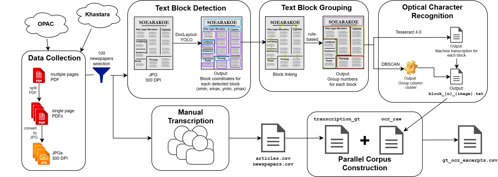

# OCR Pipeline

Layout segmentation and OCR for historical Indonesian newspaper pages.
The pipeline takes single-page JPG images and writes one OCR text file per
text block (`block_{n}_{image_file}.txt`).

In the HistoriKorpus dataset, OCR output and ground-truth transcriptions are
aligned **at the block level** (one block-level OCR file per ground-truth
text), not at the article level. Blocks are grouped into ordered partitions
that approximate article-level units, but partitions are heuristic and were
not evaluated as article boundaries.


<p align="center">
  
</p>

## Pipeline overview

PDF (multi-page) → split into single pages → render to 300-DPI JPG →
**1. block detection** → **2. block grouping** → **3. block ordering and OCR**

Steps 1–3 are implemented in `run_ocr.py`.

## 1. Prepare the input images

1. Split multi-page PDFs into single-page PDFs with PyMuPDF or any type of library that will not reduce the resolution of PDF

2. Render each page to JPG at 300 DPI. For the released dataset we used online tool to convert pdf to jpg with option 'HIGH' and outputs 

## 2. Set up the environment

System packages (Tesseract is not a pip package):

```bash
sudo apt-get update && xargs -a apt-packages.txt sudo apt-get install -y
```


## 3. Run

Before running, set the two paths at the top of the script:

```python
input_folder  = "<folder with .jpg/.png page images>"
output_folder = "<folder for results>"
```

## 4. Output structure

```
<output_folder>/
└── <image_name>/                          # page file name without extension
    ├── article_set_<image_file>.txt       # concatenated text of the page
    └── <partition_index>/                 # 1, 2, ...
        ├── block_<n>_<image_file>.txt     # OCR text of one block
        └── .partition_<k>_<image_file>.txt
```

- `<image_file>` is the page image file name **including its extension**
  (for example, `block_1_page001.jpg.txt`).
- `<n>` is the block's position in reading order within its partition,
  starting from 1.
- `<partition_index>` follows the order of the partitions' topmost blocks by
  distance to the top-left page corner, starting from 1.
- **Only the block files are paired with ground-truth transcriptions.**
  The partition and page files are convenience concatenations.

## 5. What the pipeline does

### Step 1: Block detection

- Detector: DocLayout-YOLO, run with `imgsz=2048` and `conf=0.2`; other
  prediction settings are library defaults.
- Only blocks labeled `title` or `plain text` are kept.
- Duplicate detections are removed: if two boxes overlap by an area of at
  least 75% of the smaller box, the smaller box is discarded.

### Step 2: Block grouping

Titles with width at least 1.3 × the median title width on the page are
treated as *wide* titles; other titles are *short*.

Horizontal bars (article separators) are detected with a Gaussian blur
(5×5), adaptive mean thresholding (block size 15, C = 10), morphological
opening with a 10×1 kernel (3 iterations), dilation (2 iterations), Canny
edges (50/150), and a probabilistic Hough transform (threshold 50, minimum
length 30 px, maximum gap 5 px). Bars overlapping a detected block are
discarded. Each remaining bar links the nearest blocks directly above and
below it (within 300 px) according to their types:

| Upper block | Lower block | Code |
|---|---|---|
| plain text | plain text | LEFT |
| plain text | wide title | END |
| plain text | short title | UP |
| wide title | plain text | UP |
| wide title | short title | END |
| short title | plain text | UP |
| short title | wide title | NONE |

Starting from the block nearest the bottom-left corner of the page, the
algorithm moves upward through horizontally aligned blocks until one of the
following happens:

- **END:** the group is closed.
- **UP:** the group is closed only if the block directly above is a wide
  paragraph (plain text with width at least 1.3 × the median title width);
  otherwise it continues.
- **LEFT:** if the block directly above is a title, the group continues;
  otherwise the group is attached to the group of the nearest block on its
  left, and the search resumes from the block above the bar.
- **NONE:** no effect.
- A vertical gap of at least 150 px between consecutive blocks closes the
  group.

Finally, groups whose topmost block is not the lower block of any link are
merged into the group of the block directly above, and groups are ordered by
the distance of their topmost block to the top-left page corner.

### Step 3: Block ordering and OCR

- Within each partition, blocks are clustered into columns with DBSCAN on the
  left x-coordinate of each block (`eps=200` px, `min_samples=1`). Columns
  are ordered left to right, and blocks within a column from top to bottom.
- Each block is cropped from the page image using its bounding box
  (`image[y_min:y_max, x_min:x_max]`, no padding, no further image
  processing) and passed to Tesseract through `pytesseract` with
  `lang="ind+eng+nld"` and default settings (page segmentation mode 3).
- Each block's text is saved as `block_<n>_<image_file>.txt`.

## 6. Parameter summary

| Step | Parameter | Value |
|---|---|---|
| Input | Image resolution | 300 DPI (rendered JPG) |
| Detection | Input size / confidence | `imgsz=2048` / `conf=0.2` |
| Detection | Classes kept | `title`, `plain text` |
| De-duplication | Overlap threshold | ≥ 0.75 of the smaller box |
| Titles | Wide title | width ≥ 1.3 × median title width |
| Bars | Link search distance | 300 px above/below the bar |
| Chaining | Maximum vertical gap | 150 px |
| Ordering | DBSCAN on left x-coordinate | `eps=200` px, `min_samples=1` |
| OCR | Tesseract | `ind+eng+nld`, default settings (PSM 3) |

## 7. Known limitations

- Pixel-based thresholds were tuned empirically for this corpus
  (1946–1965 newspaper layouts) and may need adjustment for other sources.
- Re-running with different hardware or library versions may slightly change
  box boundaries and therefore block numbering. Treat the released files as
  the reference.
- The script creates output folders without `exist_ok`; delete the output
  folder before re-running.
- If no horizontal bars are detected on a page, bar filtering may fail
  [fix pending / fixed in commit X].

## 8. Adapting to other archives

- Install the `tesseract-ocr-<lang>` packages for the relevant languages and
  change `lang=` accordingly.
- Re-tune the pixel-based parameters (DBSCAN `eps`, the 150 px and 300 px
  distances, the 1.3 title ratio) to your image resolution and page layout.
- Keep the model, library, and Tesseract versions fixed when comparing
  results across runs.
